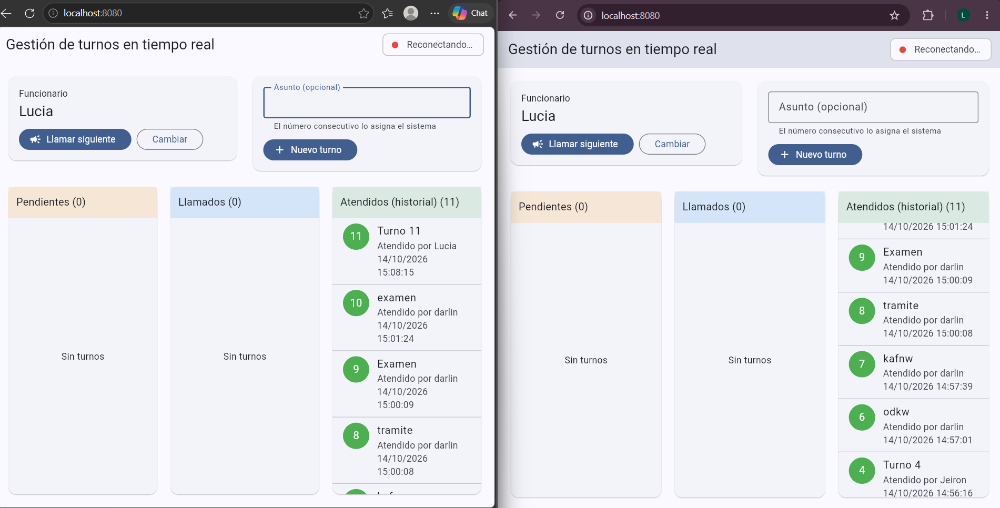
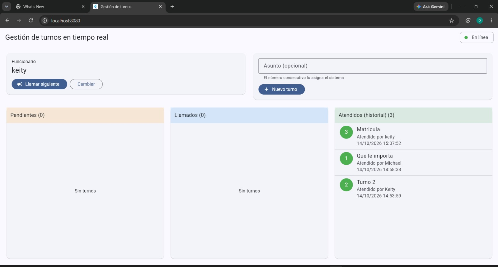

# Sistema de gestión de turnos en tiempo real

**Curso:** IF0009 – Desarrollo de Software IV · UCR Sede del Sur · Examen parcial I (parte práctica)
**Integrante(s):**
 Lucia Margarita Palacio Ayerdis.
 Keity Dayana Steller Chavarria

Aplicación web donde varios funcionarios registran, llaman y atienden turnos con sincronización
instantánea entre navegadores (sin recargar) y control de concurrencia en el servidor.

## 1. Arquitectura

```
 Flutter Web (GetX)                      Node.js (Express + ws)                SQLite
 ┌────────────────────┐   HTTP/REST     ┌──────────────────────────┐        ┌────────────┐
 │ Vistas (formularios│ ──────────────► │ Rutas /api/turnos        │        │ turnos.db  │
 │ y validaciones)    │                 │ Validación + reglas      │ ─────► │ (archivo   │
 │ TurnosController   │ ◄────────────── │ Transiciones atómicas    │ ◄───── │ persistente)│
 │ (estado reactivo)  │   WebSocket /ws │ Broadcast a clientes     │        └────────────┘
 └────────────────────┘ ◄══════════════ └──────────────────────────┘
```

| Capa | Responsabilidad |
|---|---|
| Flutter | Interfaz, validación de UX, estado reactivo (GetX), conexión WS con reconexión |
| Backend | **Toda la lógica**: validación real, consecutivo, transiciones de estado, concurrencia, difusión de eventos |
| SQLite | Persistencia; restricciones `UNIQUE` y `CHECK` como última defensa |

Tecnologías: Flutter Web + GetX + `http` + `web_socket_channel` · Node.js + Express + `ws` + `better-sqlite3`.

## 2. Instalación y ejecución

Requisitos: Node.js 18+ y Flutter SDK (con soporte web).

**Backend**
```bash
cd backend
npm install
npm start            # API en http://localhost:3000  ·  WS en ws://localhost:3000/ws
```

**Frontend**
```bash
cd frontend
flutter create --platforms=web .   # solo la primera vez: genera la carpeta web/ (conserva lib/ y pubspec.yaml)
flutter pub get
flutter run -d web-server --web-port 8080
```
Abrir `http://localhost:8080` en **dos navegadores** distintos (por ejemplo Chrome y Edge).

> Si `flutter create` sobrescribiera `lib/main.dart` o `pubspec.yaml`, restaurar los archivos de esta entrega.

## 3. API REST

| Método | Ruta | Descripción | Respuestas |
|---|---|---|---|
| GET | `/api/turnos[?estado=]` | Lista turnos (opcional: pendiente/llamado/atendido) | 200, 400 |
| POST | `/api/turnos` | Crea turno; el servidor asigna el consecutivo. Body: `{asunto?}` | 201, 400 |
| POST | `/api/turnos/siguiente` | Llama al siguiente pendiente (menor número). Body: `{funcionario}` | 200, 400, 404 |
| PATCH | `/api/turnos/:id` | Cambia estado. Body: `{estado: "llamado"\|"atendido", funcionario}` | 200, 400, 404, **409** |

Evidencia ejecutada: `evidencia_backend.txt` (operaciones REST, validaciones, persistencia tras reinicio y prueba de concurrencia).

## 4. Eventos WebSocket (servidor → cliente)

| `type` | Cuándo | Contenido |
|---|---|---|
| `snapshot` | Al conectar o reconectar | `{turnos: [...]}` con el estado real completo |
| `turno_creado` | Tras un POST exitoso | `{turno}` |
| `turno_actualizado` | Tras llamar o atender | `{turno}` |

Flujo Flutter ↔ backend: el cliente abre `ws://host:3000/ws`; el servidor envía `snapshot`; cuando cualquier
cliente ejecuta una operación REST, el servidor la confirma en la base de datos y **después** difunde el evento a
todos los clientes conectados; el `TurnosController` hace *upsert* del turno en su lista reactiva (`RxList`) y GetX
redibuja la interfaz. Las operaciones se envían por REST y las notificaciones llegan por WebSocket.

## 5. Investigación

### 5.1 HTTP vs WebSockets

| | HTTP (request/response) | WebSocket |
|---|---|---|
| Iniciativa | Solo el cliente pregunta | Cliente **y servidor** envían cuando quieran |
| Conexión | Una por solicitud (o reutilizada, pero sin estado de sesión) | Una sola conexión persistente full-duplex tras un *handshake* HTTP `Upgrade` |
| Sobrecarga | Cabeceras completas en cada solicitud | Marcos pequeños una vez establecida la conexión |
| Latencia de novedades | Depende del intervalo de *polling* | Inmediata (el servidor empuja el evento) |
| Ideal para | CRUD, consultas puntuales | Notificaciones, chat, tableros en vivo |

El *polling* periódico gasta solicitudes aunque no haya cambios y aun así llega con retraso; por eso el enunciado
exige WebSockets. Aquí se combinan: **REST para escribir** (semántica clara, códigos de estado, fácil de probar) y
**WebSocket para difundir** cambios.

### 5.2 Reconexión y sincronización
- El cliente detecta la caída por `onDone`/`onError` del stream y marca "Reconectando…" en la interfaz.
- Reintenta con **backoff exponencial** (1, 2, 4, 8, 16, 30 s) para no saturar al servidor.
- Al reconectar, el servidor envía un `snapshot`: el cliente **reemplaza** su lista con el estado real, así
  recupera cualquier cambio ocurrido mientras estuvo desconectado (no depende de haber recibido todos los eventos).
- Si una acción REST responde 409/404 el cliente llama a `GET /api/turnos` para resincronizar.
- El servidor envía *ping* cada 30 s y cierra conexiones que no responden (*heartbeat*), liberando clientes muertos.

### 5.3 Control de concurrencia utilizado
Se usa una **actualización condicional atómica** (*compare-and-set*), equivalente a bloqueo optimista:

```sql
UPDATE turnos SET estado='llamado', funcionario=?, llamado_en=...
WHERE id=? AND estado='pendiente' RETURNING *;
```

La condición `estado='pendiente'` va **dentro** del mismo `UPDATE`, de modo que la base de datos serializa las
escrituras y solo una modifica la fila. Las demás obtienen 0 filas afectadas y el servidor responde **409 Conflict**.
Se descartó el patrón "leer y luego escribir" porque dos solicitudes pueden leer `pendiente` antes de que alguna
escriba (condición de carrera, *lost update*). Otras garantías:
- Consecutivo: `MAX(numero)+1` dentro de una transacción inmediata + `UNIQUE(numero)`.
- "Llamar siguiente": el `UPDATE` selecciona el turno con subconsulta dentro de la misma sentencia atómica, así dos
  funcionarios que pulsan a la vez reciben turnos **distintos**.
- Atender: solo puede hacerlo el funcionario que lo llamó y estando en estado `llamado`.
- Validaciones duplicadas en servidor (nunca se confía en el formulario Flutter).

## 6. Pruebas
- `cd backend && npm run test:concurrencia` (con el servidor corriendo): 10 `PATCH` simultáneos al mismo turno →
  **1 × 200 y 9 × 409**; un cliente WebSocket recibe exactamente 1 evento; 5 "llamar siguiente" simultáneos →
  5 turnos distintos.
- Prueba manual con dos navegadores: crear turnos en uno y verlos aparecer en el otro; llamar un turno desde ambos a la vez y comprobar que solo uno lo logra.

## 7. Fuentes
- RFC 6455, *The WebSocket Protocol*: https://datatracker.ietf.org/doc/html/rfc6455
- MDN, *WebSockets API*: https://developer.mozilla.org/en-US/docs/Web/API/WebSockets_API
- Flutter, *Work with WebSockets*: https://docs.flutter.dev/cookbook/networking/web-sockets
- Documentación de `ws` (Node.js): https://github.com/websockets/ws
- SQLite, `RETURNING`: https://www.sqlite.org/lang_returning.html
- SQLite, transacciones: https://www.sqlite.org/lang_transaction.html
- MDN, código de estado 409 Conflict: https://developer.mozilla.org/en-US/docs/Web/HTTP/Status/409
 ## 8. Evidencia de ejecución

Dos navegadores sincronizados y reconexión automática:
 

